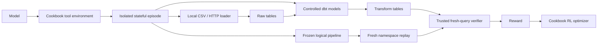

# Implementation design

The environment trains a model to construct an ELT pipeline through tools,
execute it, use errors, and submit an independently reproducible pipeline.
Initial task: `trains`, with CSV `train`, HTTP JSON `cars`, and a dbt `trains`
result containing seven requested columns.

## State and components

`TaskSpec` reads the pinned benchmark's `config.yaml`, source schema descriptions,
`data_model.yaml`, and sort keys. Connection examples and target references
never enter the prompt. Trusted source caches and target references are separate.
Fixed upstream repositories live in an external cache, outside this English-only
project repository; runtime code verifies their revisions before use. Cookbook
is installed from its exact Git revision through the dependency lock.

`DestinationAdapter` owns namespace creation, queries, base-table reads,
dbt profiles and cleanup. The default DuckDB path uses independent files with
`raw`/`transform` schemas. Its CLI starts an ephemeral Python HTTP source server
for the entire rollout/replay and closes it on exit. No Docker or database
credentials are required. Databricks is retained only as an optional adapter.

`LocalIngestor` parses CSV and fetches HTTP JSON, coerces specified types,
and replaces raw tables. The optional `AirbyteIngestor` shares its receipt interface but
uses source definitions, check/discovery, destination configuration, a
connection and a terminal-successful asynchronous sync. Healthy services or
successful connections do not prove successful ingestion.

State includes logical load configuration, receipts, SQL, execution attempts,
tool history, frozen submission and grades. State persists within an attempt;
attempts are isolated. Cookbook tools execute sequentially and stop processing
the batch immediately after submission. Stop, timeout, resource limits and
failures also end the attempt. Unsubmitted attempts receive zero.

## Submission and reward

`PipelineBundle` contains task/revision, source names and replacement modes,
fixed dbt project settings, and model SQL. No runtime schema, connector IDs,
paths or credentials are included. Submission snapshots the bundle and digest,
then executes extraction/loading/dbt in a new empty warehouse. Grading always
queries fresh warehouse tables and ignores candidate CSV evaluation caches.

For valid submissions: `reward = 0.2 L + 0.5 T + 0.3 R`.

- `L`: fraction of sources with trusted receipts and correct fresh schema/content.
- `T`: key-aligned correct-cell fraction over requested targets, zero unless
  all sources load correctly. Missing/extra rows/columns and duplicates are
  penalized. Final bundle replay also bounds this score, preventing stale
  tables from rewarding a subsequently broken model.
- `R`: one only when clean replay loads all sources, executes dbt and strictly
  matches every target.

The official functions provide numeric `rtol=0.01`, `atol=1e-9`, null equality
and trimmed case-insensitive strings. Official Stage-1/2 metrics are computed
on fresh results separately. Reward primary keys match exactly after format
normalization; official comparison may accept extra columns, duplicate keys
or close but wrong numeric keys. Those cannot earn strict replay reward.
Official Stage 2 is gated by official Stage 1.

Trusted cache/reference, network/authentication/permission failures are
infrastructure errors excluded from learning. Missing tables, columns and
SQL conversion failures are candidate errors. Reads have bounded retries;
ambiguous mutation outcomes are reconciled rather than blindly repeated.

## Safety and limitations

The model gets explicit structured tools, no shell/file access. It cannot
choose endpoints, alter dbt configuration, install dependencies, read secrets,
read references or modify grading code. Parsed SQL permits a single SELECT,
allowlisted functions and episode-owned tables. External/table functions,
catalog access, attach/copy commands, recursive CTEs, parameters and arbitrary
Jinja are blocked. DuckDB external access and extension installation/loading
are disabled. Trusted dbt profiles are mode 0600 and deleted on every exit.
SQL/models, query rows, turns, tokens, execution time, memory and feedback
size have explicit limits.

Dependency checks reject pure constant submissions and require reachable raw
source dependencies. They cannot prove semantic data use: memorized static
answers with dummy dependencies can still fool a fixed public dataset.
Stronger protection needs held-out tasks or trustworthy source perturbations
with corresponding references. Benchmark contamination is not claimed solved.
This is not a sandbox for executing arbitrary Python or shell code.

## Training and efficiency

`ELTDatasetBuilder`/`ELTEnvGroupBuilder` implement Cookbook interfaces. Lazy
initialization prevents waiting serial attempts from consuming their timeout.
The recipe reuses `do_group_rollout`, `compute_advantages`,
`assemble_training_data`, `train_step`, and checkpoint utilities. Only assistant
action tokens receive loss; tool outputs/observations are masked.

Defaults: Qwen/Qwen3.5-4B, LoRA 16, LR 1e-5, four attempts, temperature 1,
24 turns, 8192 total sampled tokens, serial execution, one update. Advantage
is reward minus group mean. Constant groups are resampled at most twice;
persistent zero effective advantage aborts the update. Optimizer futures are
awaited, state/sampler checkpoints saved, and fixed action-token logprobs
compared before/after. No observed change fails update verification.

Full grading/replay occurs only at submission. Immutable public assets and
tokenizers are cached, services reused, outputs capped, and all exits clean
owned namespace resources. New destinations reuse the same episode/RL loop.

## Budget and experiment supervision

The CLI supplies one persistent `TokenBudget` when paid access is authorized.
An explicit shared `--budget-ledger` path carries reservations across rollout,
training and recovery commands; `--max-cost-usd 10` sets the experiment estimate.
File locking and atomic writes prevent concurrent commands from allocating the
same remaining allowance. Each sampling/probe/training request is reserved
before dispatch. Completed requests settle to observed token counts; uncertain
or timed-out requests retain their allowance, including across process failure.
The estimate uses uncached Qwen3.5-4B rates, a $0.50 storage buffer and the prior
key-check estimate of $0.000008955. It is not an invoice or account spending cap.

The initial and updated state/sampler checkpoints are saved without a TTL;
actual remote storage billing continues while they are retained. The fixed
buffer neither measures storage nor caps its later charges. The recipe does not
delete these evaluation artifacts automatically. Retention and provider billing
require separate review; see [checkpoint management](https://tinker-docs.thinkingmachines.ai/tinker/howto/checkpoints/).
Recorded remote metadata contains four checkpoint files totaling 1,167,002,514
bytes, with no expiration. At $0.10/GB/month, projected storage is approximately
$0.1167/month. The final token estimate is $0.448166396 ($0.948166396 including the
fixed storage buffer); these estimates are not an invoice.

`DurableProgress` flushes turn and remote-phase events to `progress.jsonl`.
Remote waits are bounded. The separate local watchdog observes manifest/status
and tool/dbt/grade changes, log activity and child CPU progress, with 15-second
heartbeats, 900-second stall detection and a bounded phase wall limit. It owns
the child process group and terminates only that group when needed, preserving
private logs and PID/exit evidence. Its own heartbeat files do not extend the
progress deadline. Activity and process completion are distinct from a verified
reward or optimizer update. HTTP proxy fallback changes only child/process
environment; it does not modify global settings.

The minimal real Tinker key check returned `KEY_OK` (18 input, 3 output tokens).
Three standalone rollouts scored 0, 0 and 0.6285714286. The real training group
scored [0.6285714286, 1, 0, 1], including two strict-successful pipelines and
fresh replay. Nonzero advantages and 11981 effective action tokens drove an
awaited optimizer step. The original run then failed at same-client
`LoadWeights` verification (sequence 7). Separate real-API recovery restored
optimizer state into a fresh model and verified the saved update: 814 fixed
action tokens, maximum absolute logprob delta 0.19415616989135742 versus
tolerance 1e-8. Both original/recovery runtimes are non-injected. Optimization
was not repeated and the original failed manifest was preserved. The sole
post-update evaluation submitted at 13 turns with 2079 generated tokens and
reward 0.6285714286 (L=1, T=6/7, R=0); Stage 1 passed, Stage 2 failed. This
single partial outcome does not establish general quality improvement.
Latest full validation: 262 full-suite tests passed in 47.36s; 35 focused training tests passed in 3.91s; Ruff/format checked 39 files. Test counts overlap.
See [sanitized experiment evidence](evidence/2026-10-12-real-experiment).
Offline tests make no paid calls.

Offline mocks do not prove real model sampling or training. A scripted DuckDB
pipeline does not prove a model-generated official-task rollout. The current
route adapts the official Databricks task specification and reference data to
DuckDB while retaining the pinned official comparator. Tinker remains remote
and uses real API credentials. Whether this fulfills the grader's credentialed
warehouse requirement remains an acceptance interpretation, not an observed
result. See [running.md](running.md) and [acceptance.md](acceptance.md).
