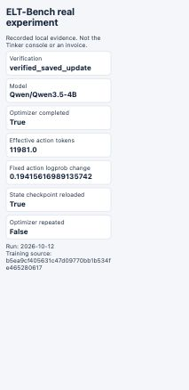

# Real experiment evidence: 2026-10-12

The official `trains` source/reference bytes were retained and the destination
was adapted to local DuckDB. Sampling and one RL update used real Tinker access.
The four training rewards were `[0.6285714286, 1, 0, 1]`. Two model pipelines
passed strict grading and clean replay, including an independent CLI replay.

The original training process failed during a same-client checkpoint reload
after optimization. Its failed record is preserved. Separate recovery loaded
the saved optimizer state into a new model without repeating optimization.
The maximum logprob change on 814 fixed action tokens was **0.1941561699**.
The only post-update evaluation earned **0.6285714286**; no general policy
improvement is claimed. Official-task rollouts used real Tinker API credentials
with the DuckDB adaptation. Cloud warehouse credentials were not used and are
not an explicit requirement in the assignment; final assessment belongs to the professor.

- [Artifact index and hashes](index.json)
- [Actual update verification and probe arrays](verification.json)
- [Model actions and sampled logprobs](train-01-actions.json)
- [Independent clean replay](train-01-success-02-standalone-replay.json)
- [Post-update evaluation](post-update-summary.json)
- [Final tests and screenshot hashes](release-validation.json)
- [Current native English Google Doc validation](google-doc-validation-submission.json)

After fetching the pinned public task assets, replay a model-produced pipeline:

```bash
uv run --locked elt-rl replay --destination duckdb \
  --bundle docs/evidence/2026-10-12-real-experiment/train-01-success-02-pipeline.json \
  --output runs/replay-recorded-model
```

The recorded token estimate is **$0.448166396**, excluding the fixed $0.50
storage buffer. Four non-expiring checkpoints total 1.167 GB, projected at
about **$0.1167/month** while retained. These are estimates, not invoices.
All experiment processes have exited and the heartbeat monitor is paused.
Credentials, original prompts, observations, tool-result rows and reference
data are excluded; complete private records remain under
`runs/real-experiment-20261012/` on the experiment host.

The screenshots show actual browser captures of a local page rendered from
recorded evidence. They are not the Tinker console or an invoice.


